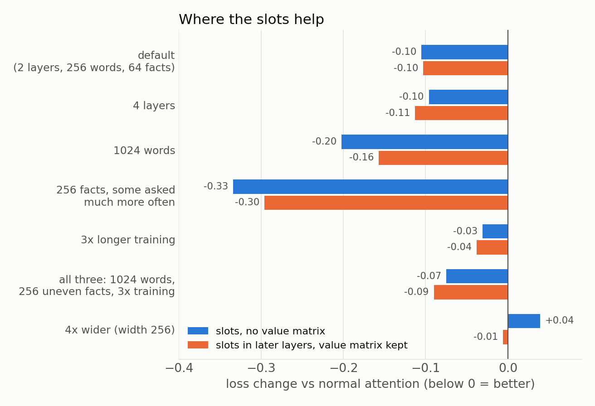
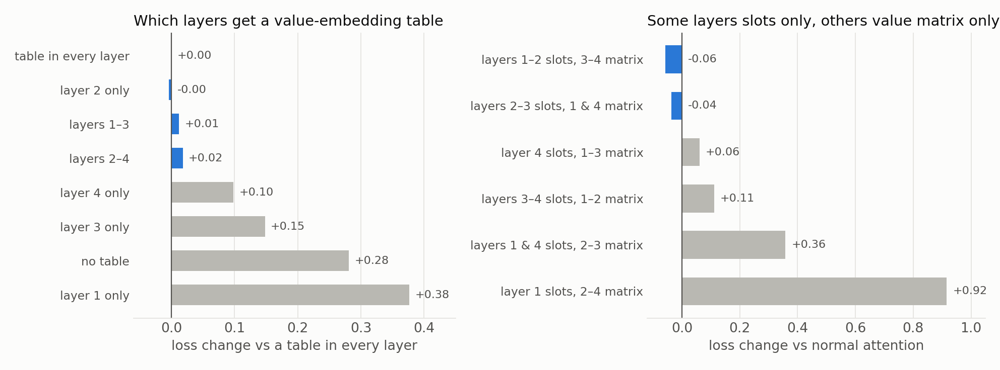

# Removing the attention value matrix

**In attention, the value matrix turns each earlier token into the vector that gets copied. I removed it. Instead, each token keeps a few learned value vectors, and the context picks which one to use. The model trained to a lower loss than with the value matrix, and each stored vector learned to hold a different kind of information about its token.**

**When to use it, from all the experiments below:**

- **Good when the model must memorize many facts**, most of all rare ones, as in real text: the largest gain of all the tests.
- **Good for copying the exact token**, such as sorting or "look up a key, then recall it".
- **Bad for information that comes from the context**: the stored vectors only know the token, so a wide model without the value matrix got much worse at lookup inside the sentence.
- **Little gain when the model already has room**: a wide model, or long training on few facts.
- **Never put the table in the first layer only.** The first layer's value already is a stored vector per token, so a table there adds nothing. One table in the second layer gave the whole gain of tables in every layer.
- **Safest version: keep the value matrix and add the slots on top.** It helped in every test and never hurt.
- **Mixing works one way:** slots only in the first layers and the value matrix only in the later layers beat normal attention; the reverse was worse.
- **The gain comes from the context choosing a row**, not from more weights: averaging the slots evenly loses half the gain.

## The core idea

When a token looks back at earlier tokens, attention copies a vector from each earlier token. That vector is called the **value**.

Normally the value comes from the **value matrix**: it turns what the model knows about the earlier token at that moment into the vector that gets copied.

Recent models (modded-nanogpt, nanochat) add a **value embedding**: a learned table with one vector per token in the vocabulary, added to the value. It works like a dictionary: look up the token, get its stored vector.

My question: if the value embedding is good enough, is the value matrix needed at all?

## What I changed

1. **Gate:** depending on the sentence, the model can scale the value embedding up or down for each token (nanochat does this).
2. **Slots:** each token gets 4 rows in the value embedding instead of 1, and the layer input picks which row to use. The MoME paper calls these rows slots.
3. **No value matrix:** the value is now only the chosen value-embedding row.

Together they reach 0.996 against 1.084 for normal attention, better on all 4 seeds. When the 4 slots are averaged evenly instead of chosen, half the gain is gone, so the gain comes from choosing a row, not from having more weights. Spending the same weights on 3 more feed-forward experts gave nothing.

## What each slot learns

In the second layer, the task decides the slot. One slot holds the token itself, used by every task that copies a token. Another holds the token's common fact, and another its rare fact.

The first layer cannot do this. Its input is only the token, before any context is read, so its slot choice is fixed per token. Slots in the second layer alone keep almost all the gain.

## Where it helps and where it does not

I changed the training one thing at a time to make it more like a large language model. The bullets at the top sum it up; [RESULTS.md](RESULTS.md) has every task.

## Which layers need the value matrix

The first layer's input is only the token, so its value is already a fixed vector per token: a value-embedding table there repeats it. Later layers have read the context, so a table there brings back the plain token, which the context has blurred.

In a 4-layer model, the second layer is the place for the table, and a table in the first layer alone was worse than no table (it also learns 32 times faster than the rest, which hurt). Splitting the layers worked when the early layers use only stored vectors and the later layers keep the value matrix to read the context. When I removed the value matrix but kept slots in every layer, no layer clearly needed it in a narrow model; in a wide model, removing it from the early layers hurt more than from the last ones, but within the noise.

This fits [ROME](https://arxiv.org/abs/2202.05262), which found facts stored in the middle layers, and [nanochat](https://github.com/karpathy/nanochat/discussions/481), which found tables in alternating layers worked best and warned against early layers only. [Bank of Values](https://arxiv.org/abs/2606.02780) replaced the values in the last third of the layers; in my split test, stored vectors only in the last layers did worse than normal attention.

## What this predicts for large language models

Large models see far more rare facts than they can memorize, and the gain held in the toy setting closest to that. **My guess: keep the value matrix and add context-chosen slots in layers after the first, starting early**, which helped in every situation and never hurt. To test it on a real model: train a size ladder with and without slots, split the loss by token frequency (the gain should sit on rare tokens), and record which slot each layer picks.

## Is this new?

Mostly no. [MoME](https://arxiv.org/abs/2609.15126) adds context-chosen slots on top of the value matrix. [Bank of Values](https://arxiv.org/abs/2606.02780) and [Memory Attention](https://arxiv.org/abs/2609.28399) replace values with a value embedding. [nanochat](https://github.com/karpathy/nanochat/discussions/481) gates the value embedding.

Not found in published work: slots with no value matrix in every layer, a measurement of what each slot holds, and the map of where it helps and where it does not.

## Setup

A small transformer trained for 5–20 seconds on a MacBook CPU, on 13 small tasks mixed into one stream: predicting the next word of text, copying, facts, key → value lookup, sorting, counting and multi-step tasks. [RESULTS.md](RESULTS.md) has every number and command, [toy/](toy/) the code and [chart.py](chart.py) the charts.
