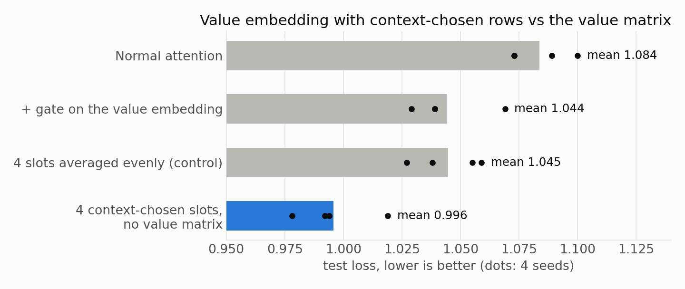
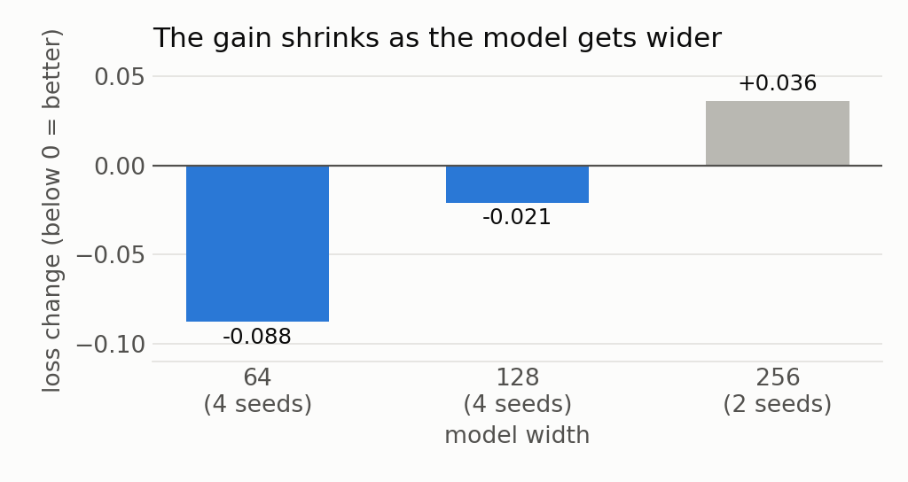

# Attention works without its value matrix when the value embedding has several rows per token, chosen by context

**In a small transformer, I removed the attention value matrix and kept only a value embedding with 4 rows per token, where the layer input picks which row to use. It learned better than normal attention on all 4 seeds.**

## The idea in plain words

When a token looks back at earlier tokens, attention copies a vector from each earlier token. That vector is called the **value**.

Normally the value comes from the **value matrix**: it turns what the model knows about the earlier token at that moment into the vector that gets copied.

Recent models (modded-nanogpt, nanochat) add a **value embedding**: a learned table with one vector per token in the vocabulary, added to the value. It works like a dictionary: look up the token, get its stored vector.

My question: if the value embedding is good enough, is the value matrix needed at all?

## What I changed

1. **Gate:** depending on the sentence, the model can scale the value embedding up or down for each token (nanochat does this).
2. **Slots:** each token gets 4 rows in the value embedding instead of 1, and the layer input picks which row to use. The MoME paper calls these rows slots.
3. **No value matrix:** the value is now only the chosen value-embedding row.

All three together give the lowest loss in the chart above: 0.996 against 1.084 for normal attention, better on all 4 seeds.

The control shows why it works. When the 4 slots are averaged evenly instead of chosen, half the gain is gone, so the gain comes from choosing a row, not from having more weights.

I also tried a version of the toy whose feed-forward part is a mixture of experts. The slots helped there too (1.389 → 1.315, all 4 seeds). Spending the same number of extra weights on 3 more experts gave nothing (1.400).

## What each slot learns

I trained the model and then checked which slot the second layer picks for each task.

Each slot holds a different kind of information about a token:

- **Slot 3** is the token itself. Every task that copies a token uses it.
- **Slot 2** is the token's common fact. Both tasks that ask for that fact use it.
- **Slot 4** is the token's rare fact.
- **Slot 1** is used for predicting the next word of text and for counting.

So the task decides the slot. A token that is copied in one sentence and asked about in another keeps both answers ready.

The first layer cannot do this. Its input is only the token, before any context is read, so its slot choice is fixed per token. Slots in the second layer alone keep almost all the gain with half the extra weights.

## Where it stops working

The gain comes from extra memory for facts. A wider model already has room for all 64 facts in this toy, so the gain shrinks as width grows and is gone at width 256.

When I gave the width-256 model 256 facts, slots helped with facts again. Without the value matrix, though, it got worse at key → value lookup in 2 of 4 runs.

**My guess for large models: keep the value matrix and add context-chosen slots, only in layers after the first.** Width 256 has only 2 seeds, so this is not settled.

## Is this new?

Mostly no. Each piece already exists:

- [MoME (arXiv 2609.15126)](https://arxiv.org/abs/2609.15126) adds context-chosen slots on top of the value matrix, which it keeps.
- [Bank of Values (arXiv 2606.02780)](https://arxiv.org/abs/2606.02780) replaces the values with a value embedding in the last third of layers.
- [Memory Attention (arXiv 2609.28399)](https://arxiv.org/abs/2609.28399) replaces the value matrix with key plus value embedding.
- [nanochat](https://github.com/karpathy/nanochat/discussions/481) uses a gated value embedding.

I found no published work on these three points:

- context-chosen slots with no value matrix in every layer;
- a measurement of what each slot holds;
- the result that slots in the first layer do nothing.

## The toy

A 2-layer transformer of width 64, trained for about 5 seconds on a MacBook CPU. Like a language model, it learns 13 small tasks mixed into one stream:

- predicting the next word of text;
- copying;
- facts;
- key → value lookup;
- sorting;
- counting;
- multi-step tasks, such as "look up a key, then recall that subject's fact".

---

- [RESULTS.md](RESULTS.md) has every number, all controls and the command for each run.
- [toy/](toy/) has the model and task code.
- [chart.py](chart.py) draws the three charts.
