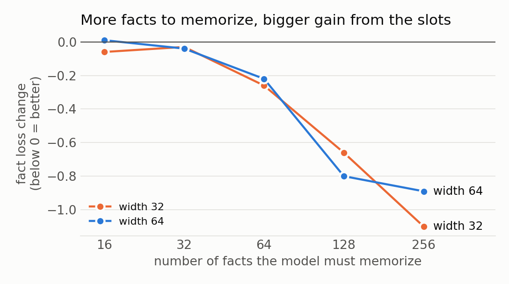

# Removing the attention value matrix

**In attention, the value matrix turns each earlier token into the vector that gets copied. I removed it. Instead, each token keeps a few learned value vectors, and the context picks which one to use. The model trained to a lower loss than with the value matrix, and each stored vector learned to hold a different kind of information about its token.**

## The core idea

When a token looks back at earlier tokens, attention copies a vector from each earlier token. That vector is called the **value**.

Normally the value comes from the **value matrix**: it turns what the model knows about the earlier token at that moment into the vector that gets copied.

Recent models (modded-nanogpt, nanochat) add a **value embedding**: a learned table with one vector per token in the vocabulary, added to the value. It works like a dictionary: look up the token, get its stored vector.

My question: if the value embedding is good enough, is the value matrix needed at all?

## What I changed

1. **Gate:** depending on the sentence, the model can scale the value embedding up or down for each token (nanochat does this).
2. **Slots:** each token gets 4 rows in the value embedding instead of 1, and the layer input picks which row to use. The MoME paper calls these rows slots.
3. **No value matrix:** the value is now only the chosen value-embedding row.

Together they reach 0.996 against 1.084 for normal attention, better on all 4 seeds. When the 4 slots are averaged evenly instead of chosen, half the gain is gone, so the gain comes from choosing a row, not from having more weights. Spending the same weights on 3 more feed-forward experts gave nothing.

## What each slot learns

In the second layer, the task decides the slot. One slot holds the token itself, used by every task that copies a token. Another holds the token's common fact, and another its rare fact.

The first layer cannot do this. Its input is only the token, before any context is read, so its slot choice is fixed per token. Slots in the second layer alone keep almost all the gain.

## Where it helps and where it does not

I changed the training situation one thing at a time to make it more like a large language model: more layers, a bigger vocabulary, many facts asked with very uneven frequency, longer training, and all of these together.

**Good at:**

- **Memorizing many facts.** The gain grows with the number of facts the model must store. It is largest when some facts are asked often and most are rare, as in real text.
- **Copying the exact token.** Sorting and "look up a key, then recall it" improve even when there are few facts, because one slot holds a clean copy of the token. With 1024 words instead of 256, copying rare words improves too.
- **More layers.** With 4 layers the gain is the same as with 2.

**Not good at:**

- **Information that comes from the context.** The value embedding only knows the token, not the sentence. At width 256 with no value matrix, key → value lookup inside the sentence got much worse. With the value matrix kept, it did not.
- **Words with many meanings.** When each word had 16 different facts, the slots barely helped. They help most when each word plays a few different roles.
- **Models that already have room.** When the model is wide or trained long on few facts, normal attention memorizes everything and the gain falls toward zero.

## What this predicts for large language models

The gain depends on how many facts the model must store compared with the room it has. Large language models are trained on far more rare facts than they can fully memorize, so they sit on the "many facts" side. In the toy setting closest to that (bigger vocabulary, many uneven facts, longer training), the gain stays.

Removing the value matrix is risky at scale, because large models do a lot of lookup inside the context. Keeping it and adding the slots in later layers gave the same gain in every situation and never hurt.

**My guess: keep the value matrix and add context-chosen slots in layers after the first.**

Three measurements would test this on a real model:

1. Train a size ladder (for example nanochat sizes) with and without slots. If the gain comes from fact room, it should shrink with size unless the data adds more facts too.
2. Split the loss by token frequency. The gain should be largest on rare tokens and rare facts.
3. Record which slot each layer picks. In later layers, the choice should follow the task (copying vs fact recall), as in the toy.

## Is this new?

Mostly no. [MoME](https://arxiv.org/abs/2609.15126) adds context-chosen slots on top of the value matrix. [Bank of Values](https://arxiv.org/abs/2606.02780) and [Memory Attention](https://arxiv.org/abs/2609.28399) replace values with a value embedding. [nanochat](https://github.com/karpathy/nanochat/discussions/481) gates the value embedding.

Not found in published work: slots with no value matrix in every layer, a measurement of what each slot holds, and the map of where it helps and where it does not.

## Setup

A small transformer trained for 5–20 seconds on a MacBook CPU, on 13 small tasks mixed into one stream: predicting the next word of text, copying, facts, key → value lookup, sorting, counting and multi-step tasks. [RESULTS.md](RESULTS.md) has every number and command, [toy/](toy/) the code and [chart.py](chart.py) the charts.
