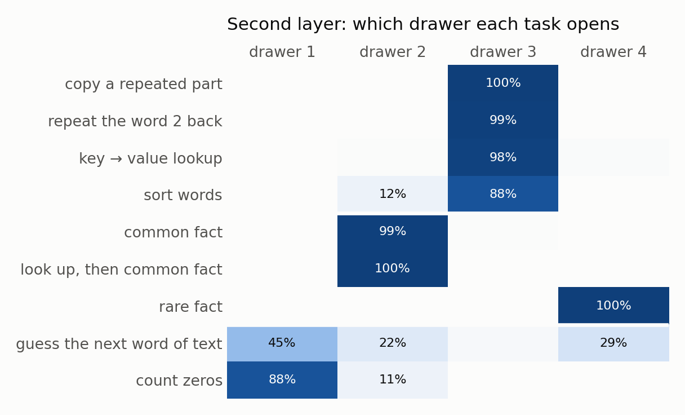

# Attention can drop its value matrix if each word gets a few "drawers"

**In a small transformer, I replaced the attention value matrix with a word table that has 4 drawers per word, and the context picks the drawer. The model learned better than normal attention on every seed.**

## The idea in plain words

When a word looks back at earlier words, attention copies a message from each earlier word. That message is called the **value**.

Normally the value is computed by a matrix (the **value matrix**) from what the model knows about that earlier word at that moment.

Some recent models (modded-nanogpt, nanochat) also add a **word table**: every word in the vocabulary has its own learned vector, and that vector is added to the value. It is a dictionary: look up the word, get its stored message.

I asked: if the dictionary is good enough, do we need the value matrix at all?

## What I changed

1. **Gate:** the model can turn the dictionary message up or down for each word, depending on the sentence (nanochat does this).
2. **Drawers:** each word gets 4 stored messages instead of 1, and the sentence picks which one to open (the MoME paper does this).
3. **No value matrix:** the value is now only the dictionary message.

The bars above show that all three together give the lowest loss: 0.996 against 1.084 for normal attention, better on all 4 seeds.

The control matters: with 4 drawers that are mixed evenly instead of picked, half the gain is gone. The gain comes from picking, not from having more numbers.

I also tried a version of the toy whose feed-forward part is a mixture of experts. There the drawers gained too (1.389 → 1.315, all 4 seeds), while spending the same number of extra weights on 3 more experts gave nothing (1.400).

## What the drawers learn

I trained the model and then looked at which drawer the second layer opens for each task.

Each drawer holds a different kind of fact about a word:

- **Drawer 3** is "the word itself". Every task that copies a word uses it.
- **Drawer 2** is the word's common fact. Both tasks that ask that fact use it.
- **Drawer 4** is the word's rare fact.
- **Drawer 1** is used for guessing the next word of text and for counting.

So the task decides which drawer opens. A word that is copied in one sentence and asked about in another can keep both answers ready.

The first layer cannot do this: at that point the model has not read the sentence yet, so its drawer choice is fixed per word. Drawers only in the second layer keep almost all the gain with half the extra weights.

## Where it stops working

The gain comes from extra memory for facts. A wider model already has room for all 64 facts in this toy, so the gain shrinks with width and is gone at width 256.

When I gave the width-256 model 256 facts, the drawers helped facts again, but with no value matrix it got worse at "key → value" lookup in 2 of 4 runs.

**So for big models my guess is: keep the value matrix and add context-picked drawers, only in layers after the first.** At width 256 I have only 2 seeds, so this is not settled.

## Is this new?

Mostly no. Each piece exists:

- Several context-picked drawers per word, added on top of the value matrix: [MoME (arXiv 2609.15126)](https://arxiv.org/abs/2609.15126). They keep the value matrix.
- Word tables that replace the value matrix: [Bank of Values (arXiv 2606.02780)](https://arxiv.org/abs/2606.02780), in the last third of layers, and [Memory Attention (arXiv 2609.28399)](https://arxiv.org/abs/2609.28399), which uses the key plus a word table.
- The gated word table: [nanochat](https://github.com/karpathy/nanochat/discussions/481).

What I did not find published: context-picked drawers with no value matrix in every layer, the measurement of what each drawer holds, and the result that the first layer's drawers do nothing.

## The toy

A 2-layer transformer, width 64, trained for about 5 seconds on a MacBook CPU. It learns 13 small tasks mixed in one stream, as a language model does: next-word guessing in text, copying, facts, key → value lookup, sorting, counting, and multi-step tasks such as "look up a key, then recall that subject's fact".

---

- [RESULTS.md](RESULTS.md): every number, all controls, and the command for each run
- [toy/](toy/): the model and task code
- [chart.py](chart.py): draws the three charts
